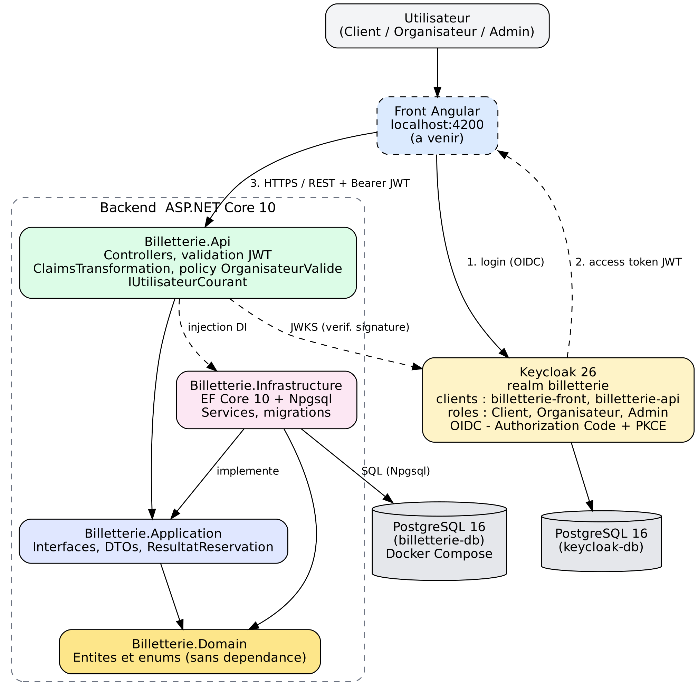
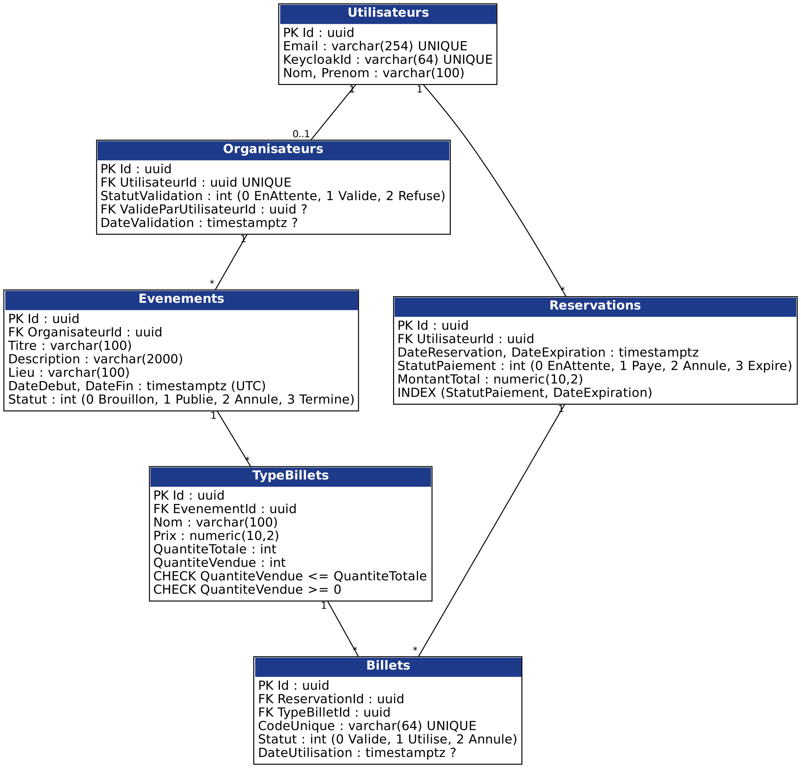

# Billetterie


Une plateforme de billetterie en ligne : des organisateurs publient des événements, des clients réservent et paient leurs places, et un administrateur valide qui a le droit d'organiser.

Je l'ai construite pour deux raisons : apprendre à faire une API sérieuse de bout en bout (authentification, droits d'accès, concurrence sur le stock), et avoir un projet concret à montrer pour mes missions en freelance. Je suis étudiant en master réseaux et cybersécurité, donc j'ai porté une attention particulière à la sécurité et à la chaîne de livraison.

> **Démo en ligne :** _à venir_
> **État du projet :** l'API est complète et testée. Le front Angular et le déploiement public sont les prochaines étapes.

## Ce que fait l'application

Trois rôles, trois usages.

**Le client**
- parcourt les événements publiés et leurs types de billet (Standard, VIP...) avec les places restantes ;
- réserve des billets : les places sont bloquées pendant 15 minutes ;
- paie sa réservation (paiement simulé pour l'instant) et reçoit ses billets avec un code unique ;
- peut annuler une réservation tant qu'elle n'est pas payée, et consulter l'historique des siennes.

**L'organisateur**
- demande à devenir organisateur, puis attend la décision d'un administrateur ;
- une fois validé : crée des événements (en brouillon), définit les types de billet et leurs quantités, publie ou annule un événement ;
- retrouve tous ses événements, y compris les brouillons.

**L'administrateur**
- consulte les demandes d'organisateur, filtrables par statut ;
- les valide ou les refuse. La décision est tracée (qui, quand), et un administrateur ne peut pas traiter sa propre demande.

## Architecture



Quatre projets .NET, avec des dépendances à sens unique :

| Projet | Rôle |
|---|---|
| `Billetterie.Domain` | Les entités et les énumérations. Aucune dépendance. |
| `Billetterie.Application` | Les interfaces des services, les DTO et les types de résultat. |
| `Billetterie.Infrastructure` | Entity Framework Core, les services, les migrations. |
| `Billetterie.Api` | Les contrôleurs, l'authentification, les règles d'accès. |

Une règle simple que je me suis imposée : **les contrôleurs ne touchent jamais à la base**. Ils appellent des services, qui manipulent les entités ; le passage entre entités et DTO se fait dans le contrôleur.

L'authentification est déléguée à **Keycloak** (OpenID Connect). L'API ne gère ni les mots de passe ni les sessions : elle vérifie seulement la signature des jetons JWT que Keycloak émet.

### Base de données



PostgreSQL 16. Les schémas au format imprimable (architecture, base de données, endpoints) sont dans [`docs/billetterie_diagrammes.pdf`](docs/billetterie_diagrammes.pdf).

## Les endpoints

Toutes les routes sont préfixées par `/api`. « Orga » signifie organisateur **validé**.

| Verbe | Route | Accès | Rôle de la route |
|---|---|---|---|
| POST | `/utilisateurs/sync` | Connecté | Crée ou met à jour l'utilisateur depuis son jeton |
| GET | `/evenements` | Public | Événements publiés |
| GET | `/evenements/{id}` | Public | Détail d'un événement publié |
| GET | `/evenements/mes-evenements` | Orga | Mes événements, tous statuts |
| POST | `/evenements` | Orga | Créer un événement (brouillon) |
| PUT | `/evenements/{id}` | Orga propriétaire | Modifier |
| POST | `/evenements/{id}/publier` | Orga propriétaire | Publier (au moins un type de billet) |
| DELETE | `/evenements/{id}` | Orga propriétaire | Annuler (suppression logique) |
| GET | `/evenements/{id}/types-billet` | Public | Types de billet et places disponibles |
| POST / PUT / DELETE | `/evenements/{id}/types-billet[/{typeId}]` | Orga propriétaire | Gérer les types de billet |
| POST | `/reservations` | Connecté | Réserver |
| GET | `/reservations`, `/reservations/{id}` | Connecté | Mes réservations |
| POST | `/reservations/{id}/payer` | Connecté propriétaire | Payer |
| POST | `/reservations/{id}/annuler` | Connecté propriétaire | Annuler (si non payée) |
| POST | `/organisateurs/demande` | Connecté | Demander à devenir organisateur |
| GET | `/organisateurs/ma-demande` | Connecté | Suivre sa demande |
| GET | `/admin/organisateurs?statut=` | Admin | Lister les demandes |
| POST | `/admin/organisateurs/{id}/valider` | Admin | Valider |
| POST | `/admin/organisateurs/{id}/refuser` | Admin | Refuser |

La documentation interactive (Scalar) est disponible sur `/scalar` quand l'API tourne en développement.

## Les choix qui m'ont demandé le plus de réflexion

**Ne jamais vendre plus de places qu'il n'y en a.** Le stock est décrémenté par une mise à jour SQL conditionnelle (`QuantiteVendue + n <= QuantiteTotale`), dans une transaction. Pas de « je lis, je calcule, j'écris » : deux clients qui réservent la dernière place en même temps ne peuvent pas l'obtenir tous les deux. Deux contraintes `CHECK` en base servent de filet de sécurité.

**Rendre les places d'une réservation abandonnée.** Une réservation non payée expire au bout de 15 minutes. Un service en arrière-plan libère régulièrement les réservations expirées et remet les places en vente. La libération est idempotente : si un paiement et une expiration arrivent au même instant, un seul des deux l'emporte, et le stock n'est rendu qu'une fois.

**Ne pas faire confiance au client.** Chaque ressource est vérifiée contre l'utilisateur connecté, côté serveur. Réserver, payer, annuler ou consulter la réservation d'un autre renvoie un `404` plutôt qu'un `403`, pour ne pas révéler qu'elle existe. Un organisateur ne peut modifier que ses propres événements et types de billet.

**Un statut d'organisateur qui fait foi en base.** Le droit d'organiser dépend de la décision enregistrée en base, pas d'un rôle collé à la main dans Keycloak. Les validations sont conditionnelles (`EnAttente` seulement), donc deux administrateurs en parallèle ne s'écrasent pas.

**Des résultats explicites plutôt que des exceptions.** Les services renvoient un résultat (`Succès` ou `Échec` avec un motif) que le contrôleur traduit en code HTTP : `400`, `404`, `409`. Les cas métier normaux ne passent pas par des exceptions.

**Détails qui comptent.** Toutes les dates sont en UTC, via `TimeProvider` (donc testables). Les annulations d'événement sont des suppressions logiques. Les codes des billets sont aléatoires et ne sont visibles qu'après paiement.

## Sécurité et livraison

- **Authentification** : Keycloak, flux Authorization Code + PKCE prévu pour le front, validation des jetons JWT (émetteur, audience, signature) côté API.
- **Autorisation** : politiques dédiées (`OrganisateurValide`, `Admin`) et contrôle de propriété dans chaque action.
- **CORS** : origines autorisées listées explicitement dans la configuration, jamais « toutes ».
- **Aucun secret dans le dépôt** : mots de passe dans un fichier `.env` ignoré par Git et dans les *User Secrets* de .NET ; un `.env.example` documente les variables attendues.
- **Intégration continue** (GitHub Actions), à chaque push :
  - compilation de la solution ;
  - vérification des paquets NuGet vulnérables (dépendances directes et transitives) ;
  - détection de secrets sur tout l'historique (Gitleaks) ;
  - scan Trivy (pour l'instant informatif, il deviendra utile avec un Dockerfile).
- **Chaîne d'approvisionnement** : actions épinglées par SHA de commit, image de runner figée, permissions minimales du jeton, Dependabot pour les mises à jour.

## Lancer le projet en local

**Prérequis :** .NET 10 SDK, Docker Desktop, Git.

```bash
git clone https://github.com/MohammedKAMH/billetterie.git
cd billetterie
```

**1. Les variables d'environnement**

```bash
cp .env.example .env
# puis éditer .env : mots de passe des bases PostgreSQL et du compte admin Keycloak
```

**2. Les bases et Keycloak**

```bash
docker compose up -d
```

Cela démarre la base de l'application, la base de Keycloak et Keycloak lui-même (`http://localhost:8080`).

**3. Configurer Keycloak** (une seule fois, je ne fournis pas encore d'export du realm)

Dans la console d'administration, créer un realm `billetterie` avec :
- les rôles de realm `Client`, `Organisateur` et `Admin` ;
- un client `billetterie-front` (public, PKCE) ;
- un client `billetterie-api`, et un mapper d'audience pour que `billetterie-api` apparaisse dans le jeton ;
- quelques utilisateurs de test.

**4. La chaîne de connexion** (dans les User Secrets, pas dans un fichier versionné)

```bash
cd backend
dotnet user-secrets set "ConnectionStrings:BilletterieDb" "Host=localhost;Port=5432;Database=billetterie;Username=<utilisateur>;Password=<mot de passe>" --project Billetterie.Api
```

**5. Les migrations puis l'API**

```bash
dotnet ef database update --project Billetterie.Infrastructure --startup-project Billetterie.Api
dotnet run --project Billetterie.Api
```

L'API écoute sur `http://localhost:5178`, la documentation sur `http://localhost:5178/scalar`.

## Lancer avec Docker

```bash
cp .env.example .env     # puis renseigner les mots de passe
docker compose up -d --build
```

L'API est alors disponible sur `http://localhost:5178`.
## Tests

Je teste l'API de bout en bout avec des scripts PowerShell qui obtiennent de vrais jetons Keycloak et vérifient les codes HTTP, les statuts et l'état de la base. Ils couvrent : les droits d'accès par rôle, les cas limites des réservations (stock, expiration, concurrence, transactions), le flux complet de validation d'un organisateur.

> _À compléter : lien vers le dossier des scripts une fois versionné, et mot sur la migration vers de vrais tests automatisés dans la CI._

## Limites actuelles et suite

- Pas encore de front : un client Angular est prévu, avec une maquette Figma d'abord.
- Le paiement est simulé : aucune intégration avec un prestataire réel.
- Pas d'envoi d'e-mails (confirmation de réservation) : prévu via un service de test type Mailpit.
- Pas de `Dockerfile` pour l'API : indispensable pour déployer la démo publique et scanner l'image avec Trivy.
- Les tests ne tournent pas encore dans la CI : ils dépendent d'un Keycloak et d'une base réels.

## Auteur

Mohammed KAMH, étudiant en master Développement et cybersécurité à l'ISIMA (Clermont-Ferrand).
